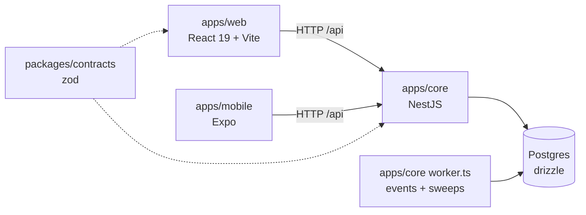
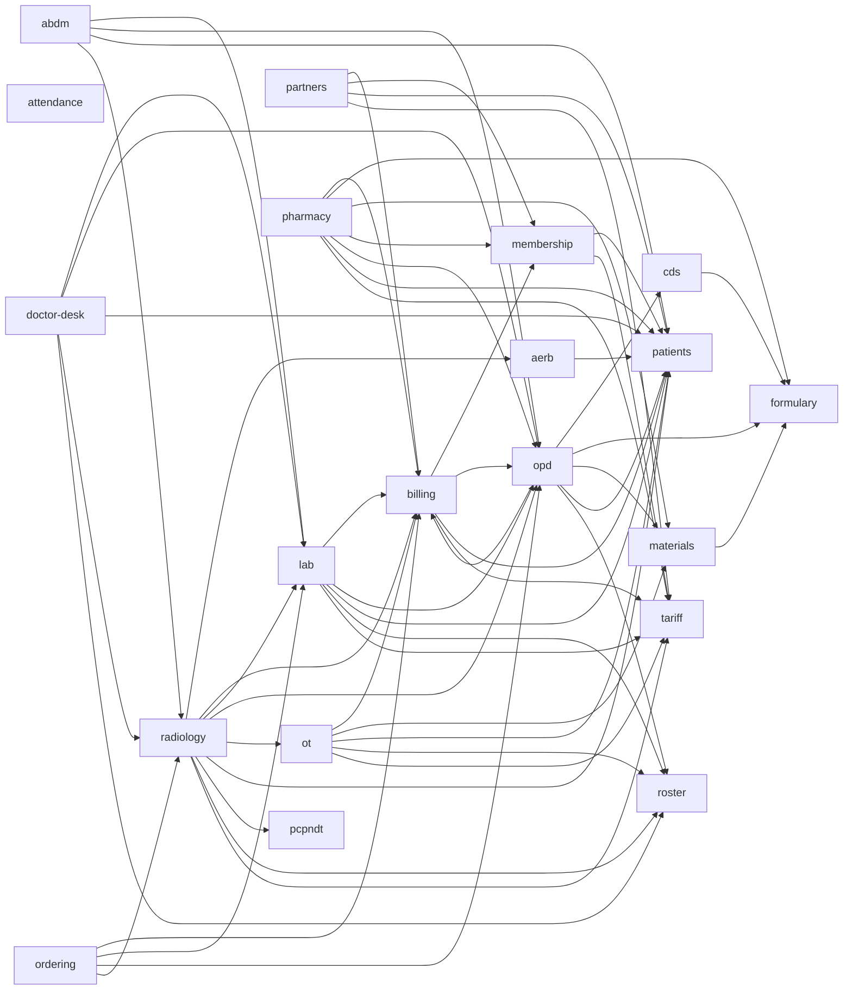

<!-- GENERATED by `node tools/arch/gen.mjs` — do not edit by hand. CI fails when this file is stale. -->

# HMIS architecture map

Generated from the source tree. Read this before exploring code; open a module page for its
dependencies, public API, routes and tables. Regenerate after you change structure:
`node tools/arch/gen.mjs`. After a rebase conflict in this folder, regenerate instead of merging by hand.

## System

## Module dependencies (core)

Arrow = imports through the target's `index.ts`. Shared modules (many arrows in) are expensive to change.

## Modules

| module | depends on | used by |
|---|---|---|
| [abdm](modules/abdm.md) | lab, opd, patients, radiology | — |
| [aerb](modules/aerb.md) | patients | radiology |
| [attendance](modules/attendance.md) | — | — |
| [billing](modules/billing.md) | membership, opd, patients, tariff | lab, opd, ordering, ot, partners, pharmacy, radiology |
| [cds](modules/cds.md) | formulary | opd |
| [doctor-desk](modules/doctor-desk.md) | lab, opd, patients, radiology, roster | — |
| [formulary](modules/formulary.md) | — | cds, materials, opd, pharmacy |
| [lab](modules/lab.md) | billing, opd, patients, roster, tariff | abdm, doctor-desk, ordering, radiology |
| [materials](modules/materials.md) | formulary | opd, ot, pharmacy |
| [membership](modules/membership.md) | patients, tariff | billing, partners, pharmacy |
| [opd](modules/opd.md) | billing, cds, formulary, materials, patients, roster | abdm, billing, doctor-desk, lab, ordering, pharmacy, radiology |
| [ordering](modules/ordering.md) | billing, lab, opd, radiology | — |
| [ot](modules/ot.md) | billing, materials, patients, roster, tariff | radiology |
| [partners](modules/partners.md) | billing, membership, patients, tariff | — |
| [patients](modules/patients.md) | — | abdm, aerb, billing, doctor-desk, lab, membership, opd, ot, partners, pharmacy, radiology |
| [pcpndt](modules/pcpndt.md) | — | radiology |
| [pharmacy](modules/pharmacy.md) | billing, formulary, materials, membership, opd, patients, tariff | — |
| [radiology](modules/radiology.md) | aerb, billing, lab, opd, ot, patients, pcpndt, roster, tariff | abdm, doctor-desk, ordering |
| [roster](modules/roster.md) | — | doctor-desk, lab, opd, ot, radiology |
| [tariff](modules/tariff.md) | — | billing, lab, membership, ot, partners, pharmacy, radiology |

## Kernel subsystems

Shared platform code in `apps/core/src/kernel/`. Coordinate before editing (see CLAUDE.md).

| subsystem | used by modules | depends on kernel | serves HTTP |
|---|---|---|---|
| `alerts` | attendance, doctor-desk, lab, opd, roster | approvals, auth, db, events, modules, notify, ops, realtime, reminders, tokens, workflow | yes |
| `approvals` | abdm, aerb, attendance, billing, doctor-desk, formulary, lab, materials, membership, ot, partners, patients, pcpndt, pharmacy, radiology, roster, tariff | alerts, auth, db, events, modules, phi, tokens, workflow | yes |
| `auth` | abdm, aerb, attendance, billing, doctor-desk, formulary, lab, materials, membership, opd, ordering, ot, partners, patients, pcpndt, pharmacy, radiology, roster, tariff | config, crypto, db, events, modules, printing, push, ratelimit, tokens | yes |
| `config` | abdm, attendance, billing, formulary, lab, membership, opd, ot, partners, patients, pharmacy, radiology | modules | — |
| `copilot` | billing, doctor-desk, formulary, lab, opd, pharmacy, roster | alerts, approvals, auth, config, db, desk, events, inference, modules, ratelimit, reminders, search, tokens, workflow | yes |
| `crypto` | abdm, billing, opd, patients | — | — |
| `db` | abdm, aerb, attendance, billing, cds, doctor-desk, formulary, lab, materials, membership, opd, ordering, ot, partners, patients, pcpndt, pharmacy, radiology, roster, tariff | — | — |
| `desk` | attendance, billing, doctor-desk, lab, membership, opd, partners, patients, pharmacy, radiology, roster | approvals, auth, db, events, modules, reminders, report, tokens, workflow | yes |
| `documents` | lab, patients, pharmacy | — | — |
| `episodes` | billing, lab, materials, opd, ot, pharmacy, radiology | db | — |
| `events` | abdm, aerb, attendance, billing, doctor-desk, formulary, lab, materials, membership, opd, ordering, ot, partners, patients, pcpndt, pharmacy, radiology, roster, tariff | db, worker | — |
| `inference` | formulary, lab, opd | auth, config, db, ratelimit, search, tokens | yes |
| `modules` | abdm, aerb, attendance, billing, doctor-desk, formulary, lab, materials, membership, opd, ordering, ot, partners, patients, pcpndt, pharmacy, radiology, roster, tariff | alerts, approvals, auth, config, copilot, desk, ops, orders, resources, search, workflow | — |
| `notify` | abdm, lab, pharmacy, radiology | auth, config, db, events, modules, tokens, workflow | yes |
| `obligations` | — | alerts, db, events, modules, workflow | — |
| `ops` | lab, pharmacy | auth, config, crypto, db, events, modules, tokens | yes |
| `orders` | lab, ordering, pharmacy, radiology | auth, db, episodes, events, modules, phi | — |
| `phi` | abdm, aerb, billing, doctor-desk, lab, opd, patients, pcpndt, pharmacy, radiology | db | — |
| `printing` | billing, lab, opd, pharmacy, roster | auth, crypto, db, events, phi, tokens | yes |
| `push` | — | alerts, db, events, modules | — |
| `ratelimit` | — | — | — |
| `realtime` | lab, opd | auth, db, tokens | — |
| `reminders` | — | alerts, auth, copilot, db, tokens | yes |
| `report` | billing, lab, opd, pharmacy, radiology | db | — |
| `resources` | aerb, lab, materials, opd, ot, pharmacy, radiology | auth, db, events, modules, tokens | yes |
| `retention` | — | db, events, phi, search, worker | — |
| `search` | billing, formulary, membership, opd, patients, tariff | auth, config, db, events, modules, tokens | yes |
| `tokens` | abdm, aerb, attendance, billing, doctor-desk, formulary, lab, materials, membership, opd, ordering, ot, partners, patients, pcpndt, pharmacy, radiology, roster, tariff | — | — |
| `worker` | — | alerts, approvals, auth, config, copilot, db, desk, documents, events, modules, notify, obligations, ops, orders, push, reminders, resources, retention, tokens, workflow | — |
| `workflow` | attendance, billing, lab, materials, membership, opd, ot, patients, pharmacy, radiology, roster, tariff | auth, db, events, modules, tokens | yes |

Kernel HTTP routes: [kernel-routes.md](kernel-routes.md). Database: [schema.md](schema.md). Web screens: [web.md](web.md).
